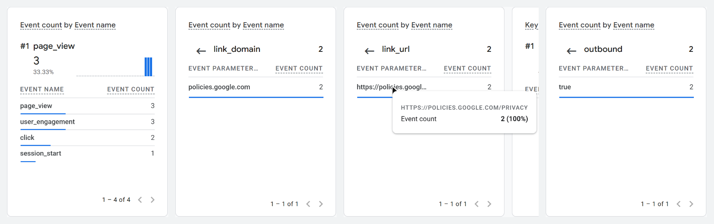

# Exercise 6 results: Zoho Mail and GA4 for `caelonk.me`

- **Domain address:** `caelon@caelonk.me` (Zoho Mail)
- **Outside mailbox:** a personal Gmail address I control, written below as
  `<external Gmail>`

All times are UTC.

## 1. Email tests

| Test | From → To | Sent | Result |
|---|---|---|---|
| Before MX | `<external Gmail>` → `caelon@caelonk.me`, before any Zoho record existed | 2026-10-13 21:09:06 | **Bounced** at 21:09:18: `Remote-MTA: eforward2.registrar-servers.com`, `554 5.7.1 <caelon@caelonk.me>: Relay access denied`. The domain had no Zoho MX yet, but Namecheap's forwarding MX records were still published (since 2026-10-06), and their server rejected it |
| Received | `<external Gmail>` → `caelon@caelonk.me` | 2026-10-13 22:09:14 | **Arrived** in the Zoho inbox at 22:09:28 |
| Replied | `caelon@caelonk.me` → `<external Gmail>` (reply to the received test, from Zoho webmail) | 2026-10-15 18:57:30 | **Arrived** in the Gmail inbox at 18:57:35, in the same thread as the received test |
| Sent a new message | `caelon@caelonk.me` → `<external Gmail>` (Zoho webmail) | 2026-10-13 21:56:09 | **Arrived** in the Gmail inbox at 21:56:12 |

**How I checked (2026-10-19):** Claude Code used the Zoho Mail MCP server
(`listEmails` on the Inbox and Sent folders) to find all three messages on the
Zoho side. To check the outside mailbox, it used a Gmail connector
(`search_threads`). Both outgoing messages show up there with Gmail's `INBOX`
label, so they arrived and didn't go to spam.

Two more incoming tests at 21:53 and 21:55 also bounced from Namecheap while
both sets of MX records were published. Deleting the Namecheap records at 22:06
fixed it. Details, and the full header analysis, are in
[`zoho-header-check.md`](zoho-header-check.md).

## 2. SPF, DKIM and DMARC results

The Zoho MCP server can't read message headers, so these results come from
the outside mailbox. Gmail's **Show original** view for the reply test (the
external address is redacted, and routing IDs and signature data are trimmed):

```text
Return-Path: <caelon@caelonk.me>
Received: from sender6-of-o52.zoho.com (sender6-of-o52.zoho.com. [165.173.180.52])
        by mx.google.com with ESMTPS ... for <external Gmail>; Thu, 15 Oct 2026 11:57:35 -0700 (PDT)
Received-SPF: pass (google.com: domain of caelon@caelonk.me designates 165.173.180.52 as permitted sender) client-ip=165.173.180.52;
Authentication-Results: mx.google.com;
       dkim=pass header.i=@caelonk.me header.s=zmail header.b=Z8SIVwDW;
       arc=pass (i=1 spf=pass spfdomain=caelonk.me dkim=pass dkdomain=caelonk.me dmarc=pass fromdomain=caelonk.me>);
       spf=pass (google.com: domain of caelon@caelonk.me designates 165.173.180.52 as permitted sender) smtp.mailfrom=caelon@caelonk.me;
       dmarc=pass (p=NONE sp=NONE dis=NONE) header.from=caelonk.me
From: Caelon <caelon@caelonk.me>
Subject: Re: Test 01
```

**Summary:**
- **SPF: pass.** Zoho's server `165.173.180.52` is allowed by the domain's SPF
  record, and the envelope sender is on `caelonk.me`.
- **DKIM: pass.** The signature uses selector `zmail` and domain `d=caelonk.me`.
- **DMARC: pass** under the `p=none` policy. SPF and DKIM both line up with the
  `From:` domain, `caelonk.me`.

Gmail's copy of the new-message test also shows `spf=pass` and `dkim=pass`.
It has no Gmail `dmarc=` entry, because it was sent at 21:56. The `_dmarc`
record wasn't published until 22:01.

## 3. Live site and GA4 events

- **Live site:** <https://caelonk.me/>
- **Privacy page:** <https://caelonk.me/privacy>

**Test (2026-10-19, about 15:12 to 15:14 UTC):** in Chrome, which doesn't
send Global Privacy Control, I loaded the Privacy page and clicked its
**Google Privacy Policy** link, which goes to another site. GA4's enhanced
measurement records a click like that as an outbound `click` event. The
GA4 Realtime report for the `caelonk.me` property shows:



Left to right, the panels show:
1. **Event counts:** `page_view` 3 (three loads of the Privacy page during
   the test) and `click` 2.
2. **`link_domain`:** `policies.google.com`.
3. **`link_url`:** `https://policies.google.com/privacy`.
4. **`outbound`:** `true`.

Each panel is the same Realtime card, opened on a different event or
parameter.

## 4. How a visit reaches GA4, and what the checks show

*Written 2026-10-20, after the test, from the code and the screenshot above.*

1. The browser loads a page from `caelonk.me`. `app/templates/base.html` runs a
   short inline script unless the browser sends Global Privacy Control, and
   unless the page is under `/admin` or `/auth`.
2. That script sets up `gtag` with measurement ID `G-6J1F90ST16` and loads
   Google's `gtag.js` from `www.googletagmanager.com`. Nothing about the visit
   goes through Railway or the app: the app only sends the HTML.
3. `gtag.js` sends a `page_view` hit from the visitor's browser straight to
   Google Analytics over HTTPS. With enhanced measurement on, it also watches
   for clicks on links to other domains and sends those as `click` events with
   `link_url`, `link_domain` and `outbound=true`.
4. GA4's Realtime report shows events from roughly the last 30 minutes.

**What the check shows.** The Realtime card counted `page_view` and an outbound
`click` to `policies.google.com` during the 2026-10-19 test, so the tag on the
live site was collecting, and enhanced measurement recorded the outbound click.
It doesn't show that every visit is counted: a visitor who sends GPC, or blocks
`googletagmanager.com`, sends nothing, by design.

**Why the outbound click is useful.** The site's job is to send recruiters
somewhere next. A `page_view` only says someone arrived; an outbound `click` with
`link_domain` shows which link to another site they followed. The same event
covers the GitHub link on the home page and any external link on a project
page. Resume downloads and email links stay on `caelonk.me` or open a mail
program, so they aren't outbound clicks; whether GA4 records them another way
hasn't been checked.
