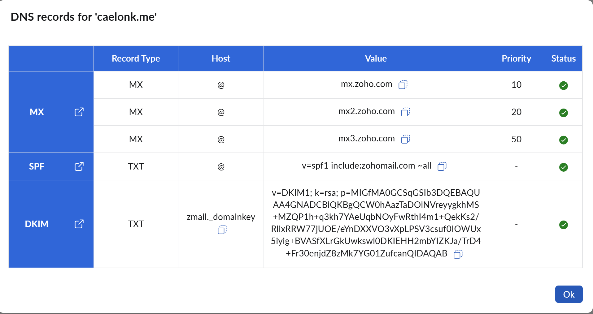

# Exercise 6 evidence: mail for `caelonk.me` with Zoho Mail

- **Domain address:** `caelon@caelonk.me`
- **External mailbox:** a personal Gmail address I control, written below as
  `<external Gmail>`
- **Setup date:** 2026-10-13. **Public checks and reply test:** 2026-10-15.
- **DNS snapshots:** [before Zoho](dns-before-zoho.md) and
  [after Zoho](dns-after-zoho.md)

All times are UTC. Zoho and Gmail headers show Pacific time (`-0700`), which I
converted.

> **Status: complete.** DNS, all four delivery tests, the Zoho Admin Console
> verification and the mailbox inventory are done. Reading DMARC aggregate
> reports is left out on purpose (section 7).

## 1. Mailbox and routing inventory

What received mail before the change, plus the Zoho settings checked after it.

| Item | What I found | How I checked |
|---|---|---|
| MX records | Five `eforward1` to `eforward5.registrar-servers.com` (Namecheap email forwarding), copied in when the zone moved to Cloudflare on 2026-10-06 | `cf dns records list`, saved in the before snapshot |
| Forwarding destinations | None working. Namecheap's server answered `554 5.7.1 <caelon@caelonk.me>: Relay access denied`, so no forwarding was set up for the domain | Test 1 (section 5) and an SMTP check against `eforward1` on 2026-10-13 |
| Mailboxes and aliases | None existed before Zoho | Only the Namecheap MX records existed, and they rejected mail |
| Cloudflare Email Routing | Disabled, status `unconfigured`. Its catch-all rule is the default `drop` action, also disabled | `cf email-routing settings get` and `cf email-routing rules list-account`, 2026-10-15 |
| Zoho aliases (after setup) | None. `caelon@caelonk.me` lists only its own mailbox address | Admin Console → Users → Caelon → Mailbox Settings → Email Alias, 2026-10-15 ([screenshot](ex06-zoho-aliases.png)) |
| Zoho catch-all (after setup) | **On**, delivering to `caelon@caelonk.me`, with no excluded addresses | Admin Console → Domains → caelonk.me → Advanced Settings → Catch-all Address, 2026-10-15 ([screenshot](ex06-zoho-catchall.png)) |

The only recipient I need is `caelon@caelonk.me`. DMARC reports also go to that
address. Because the catch-all is on, mail sent to any other address at
`caelonk.me` (for example a typo) is also delivered to this mailbox instead of
bouncing. The trade-off is that spam sent to made-up addresses lands there too.
The forwarding that existed before the cutover was Namecheap's, and it had no
working destinations (the row above). Zoho groups and Zoho forwarding aren't
part of this inventory, because the Zoho organization was new and had nothing
before setup. Its destination is the Zoho mailbox, created before the MX change. Zoho
emailed `<external Gmail>` at 21:24 on 2026-10-13 to confirm the new address.

## 2. DNS records and what each one does

Mail records only. The website records stay as they were and are not mail
records: the `caelonk.me` CNAME to Railway, the proxied `www` placeholder, and
`_railway-verify`.

| Type | Host | Value | Purpose |
|---|---|---|---|
| TXT | `caelonk.me` | `zoho-verification=zb04468953.zmverify.zoho.com` | Proves to Zoho that I control the domain |
| MX | `caelonk.me` | `mx.zoho.com` 10, `mx2.zoho.com` 20, `mx3.zoho.com` 50 | Tells other mail servers to deliver `@caelonk.me` mail to Zoho, lowest number first |
| TXT (SPF) | `caelonk.me` | `v=spf1 include:zohomail.com ~all` | Lists the servers allowed to send mail for the domain |
| TXT (DKIM) | `zmail._domainkey.caelonk.me` | `v=DKIM1; k=rsa; p=MIGfMA0G...canQIDAQAB` (1024-bit; full key in the after snapshot) | Public key that receivers use to check Zoho's signatures |
| TXT (DMARC) | `_dmarc.caelonk.me` | `v=DMARC1; p=none; rua=mailto:caelon@caelonk.me` | Tells receivers what to do when SPF and DKIM fail to line up, and where to send reports |

**Order of changes:** the verification TXT came first, at 21:23. Then the
Zoho MX at 21:35 and 21:36, SPF and DKIM at 21:37, and DMARC at 22:01. The old
Namecheap MX records were deleted at 22:06. Between 21:35 and 22:06 both sets of
MX records were published, and tests sent then could reach either server
(section 5).

**Comparison with Zoho's Cloudflare guide**
(<https://www.zoho.com/mail/help/adminconsole/cloudflare.html>, read
2026-10-15):

| Record | Guide | Published | Note |
|---|---|---|---|
| MX | Remove existing MX records, then add `mx`, `mx2`, `mx3.zoho.com` at 10, 20, 50 | Same, with the old records removed | Match |
| SPF | `v=spf1 include:zohomail.com -all` | `v=spf1 include:zohomail.com ~all` | Differs in the final qualifier (see below) |
| DKIM | Selector shown in the guide's example as `zoho._domainkey`; the guide says to copy the exact host from the Admin Console | `zmail._domainkey` | Gmail's check passed with `s=zmail` (section 6), so this is the selector Zoho signs with |
| DMARC | The guide doesn't cover it | `p=none` monitoring policy | See section 3 |

The Admin Console's values control. Its "DNS records for 'caelonk.me'" page
(section 7) lists `v=spf1 include:zohomail.com ~all`, the `zmail._domainkey`
host and the same DKIM key, and MX 10, 20, 50. So the published records match
the console, and the guide's `-all` is only its example.

## 3. How SPF, DKIM and DMARC work here

**SPF** is one TXT policy listing the servers allowed to send mail for
`caelonk.me`. `include:zohomail.com` pulls in Zoho's published list of sending
servers. The receiver checks the address in the envelope sender (the
`Return-Path`), not the `From:` line people see. `~all` means "treat other
senders as suspicious" (softfail). `-all` means "reject them" (hardfail). The
guide uses `-all`. I left `~all` in place while testing. With DMARC in place,
either works, since DMARC decides the outcome. A hostname must have only one SPF
policy, because two `v=spf1` records make the SPF check fail. The domain has
one.

**DKIM** adds a signature to every message Zoho sends, covering the headers
(`From`, `To`, `Subject`, `Date`) and the body. The receiver uses the selector
(`s=zmail`) and domain (`d=caelonk.me`) to fetch the public key from DNS and
check the signature. A pass proves two things: the message hasn't changed in
transit, and it was signed by someone holding the domain's private key. That is
why a forged message can't simply copy the `From:` line. The **private key lives
on Zoho's sending servers**. It never appears in DNS, in this repository, or on
my laptop. Only the public half is published.

**DMARC** links those checks to the visible `From:` domain through
**alignment**. SPF aligns when the envelope sender's domain matches the `From:`
domain. DKIM aligns when the signature's `d=` domain matches it. A message
passes DMARC if SPF or DKIM passes **and** is aligned. `p=none` asks receivers
to deliver mail either way and report the results to the `rua` address, which
is `caelon@caelonk.me` on my own domain. Before publishing, `_dmarc` had no
record (before snapshot), so there was no stricter policy to keep. Once the
reports show clean results, the policy can move to `quarantine` and then
`reject`.

## 4. Public DNS lookups

Run on 2026-10-15 at 18:53 UTC with
`Resolve-DnsName <name> -Type <type> -Server <resolver> -DnsOnly`.

| Lookup | `8.8.8.8` (Google) | `1.1.1.1` (Cloudflare) |
|---|---|---|
| MX `caelonk.me` | `mx.zoho.com` 10, `mx2.zoho.com` 20, `mx3.zoho.com` 50 | Same |
| TXT `caelonk.me` | `v=spf1 include:zohomail.com ~all`, `zoho-verification=zb04468953.zmverify.zoho.com` | Same |
| TXT `zmail._domainkey.caelonk.me` | `v=DKIM1; k=rsa; p=MIGfMA0G...canQIDAQAB` | Same |
| TXT `_dmarc.caelonk.me` | `v=DMARC1; p=none; rua=mailto:caelon@caelonk.me` | Same |

Both resolvers match the Cloudflare zone (`cf dns records list`, same time).
On 2026-10-13, one `8.8.8.8` lookup seconds after the old MX records were
deleted still returned them from cache. That is covered in the after snapshot.

## 5. Delivery tests

| # | Test | Sender | Receiver | Time (UTC) | Observed result |
|---|---|---|---|---|---|
| 1 | Before setup | `<external Gmail>` | `caelon@caelonk.me` | 2026-10-13 21:09:06 | **Bounced** at 21:09:18. `Remote-MTA: eforward2.registrar-servers.com`, `554 5.7.1 <caelon@caelonk.me>: Relay access denied` |
| 2 | Incoming | `<external Gmail>` | `caelon@caelonk.me` | 2026-10-13 22:09:14 | **Received** in the Zoho inbox (I confirmed it in Zoho webmail on 2026-10-15). Gmail returned no bounce. I didn't save a screenshot; test 3's reply quotes this message's sender, date and subject |
| 3 | Reply from Zoho | `caelon@caelonk.me` (reply to test 2 in Zoho webmail) | `<external Gmail>` | 2026-10-15 18:57:30 | **Received** in the Gmail inbox at 18:57:35, in the same thread as test 2, `From: Caelon <caelon@caelonk.me>`. SPF, DKIM and DMARC passed (section 6) |
| 4 | New outgoing | `caelon@caelonk.me` (Zoho webmail) | `<external Gmail>` | 2026-10-13 21:56:09 | **Received** in the Gmail inbox at 21:56:12, `From: Caelon <caelon@caelonk.me>`. SPF and DKIM passed (section 6) |

**Test 1 timing.** It ran before any Zoho record existed (the verification TXT
came at 21:23), but the old Namecheap MX records were still published. So the
"before" result is Namecheap rejecting the message, not a missing MX record.

**Two more incoming attempts during the cutover** also bounced, from
`eforward1.registrar-servers.com` with the same `554 Relay access denied`: one
at 21:53:35 (bounce 21:53:46) and one at 21:55:28 (bounce 21:55:40). At that
point the Zoho and Namecheap MX records were both published, and `eforward1`
shared priority 10 with `mx.zoho.com`, so Gmail sometimes chose Namecheap.
*Investigation:* both bounce notices name the Namecheap server. An SMTP check
against `eforward1` reproduced the rejection without sending a message.
*Fix:* the five Namecheap MX records were deleted at 22:06. Test 2 was sent
after that, and no bounce came back.

## 6. Authentication results (tests 3 and 4)

Gmail lets me see the original message, headers included. In both excerpts the
external address and display name are redacted, routing IDs and signature data
are trimmed, and the body is removed.

### Test 3: reply from Zoho

```text
Return-Path: <caelon@caelonk.me>
Received: from sender6-of-o52.zoho.com (sender6-of-o52.zoho.com. [165.173.180.52])
        by mx.google.com with ESMTPS ... for <external Gmail>
        (version=TLS1_3 cipher=TLS_AES_256_GCM_SHA384 bits=256/256);
        Thu, 15 Oct 2026 11:57:35 -0700 (PDT)
Received-SPF: pass (google.com: domain of caelon@caelonk.me designates 165.173.180.52 as permitted sender) client-ip=165.173.180.52;
Authentication-Results: mx.google.com;
       dkim=pass header.i=@caelonk.me header.s=zmail header.b=Z8SIVwDW;
       arc=pass (i=1 spf=pass spfdomain=caelonk.me dkim=pass dkdomain=caelonk.me dmarc=pass fromdomain=caelonk.me>);
       spf=pass (google.com: domain of caelon@caelonk.me designates 165.173.180.52 as permitted sender) smtp.mailfrom=caelon@caelonk.me;
       dmarc=pass (p=NONE sp=NONE dis=NONE) header.from=caelonk.me
DKIM-Signature: v=1; a=rsa-sha256; q=dns/txt; c=relaxed/relaxed; s=zmail; d=caelonk.me; ...
Date: Thu, 15 Oct 2026 11:57:30 -0700
From: Caelon <caelon@caelonk.me>
To: <external Gmail>
In-Reply-To: <...@mail.gmail.com>
Subject: Re: Test 01
```

Here Gmail's own result includes `dmarc=pass (p=NONE ...)`. It found the
published `p=none` policy, and SPF and DKIM both passed aligned with
`caelonk.me`. `dis=NONE` means Gmail took no action against the message.

### Test 4: new outgoing message

```text
Return-Path: <caelon@caelonk.me>
Received: from sender5-of-o56.zoho.com (sender5-of-o56.zoho.com. [165.173.182.56])
        by mx.google.com with ESMTPS ... for <external Gmail>
        (version=TLS1_3 cipher=TLS_AES_256_GCM_SHA384 bits=256/256);
        Tue, 13 Oct 2026 14:56:12 -0700 (PDT)
Received-SPF: pass (google.com: domain of caelon@caelonk.me designates 165.173.182.56 as permitted sender) client-ip=165.173.182.56;
Authentication-Results: mx.google.com;
       dkim=pass header.i=@caelonk.me header.s=zmail header.b="AIcUEc/W";
       arc=pass (i=1 spf=pass spfdomain=caelonk.me dkim=pass dkdomain=caelonk.me dmarc=pass fromdomain=caelonk.me>);
       spf=pass (google.com: domain of caelon@caelonk.me designates 165.173.182.56 as permitted sender) smtp.mailfrom=caelon@caelonk.me
ARC-Authentication-Results: i=1; mx.zohomail.com;
	dkim=pass  header.i=caelonk.me;
	spf=pass  smtp.mailfrom=caelon@caelonk.me;
	dmarc=pass header.from=<caelon@caelonk.me>
DKIM-Signature: v=1; a=rsa-sha256; q=dns/txt; c=relaxed/relaxed; s=zmail; d=caelonk.me; ...
Date: Tue, 13 Oct 2026 14:56:09 -0700
From: Caelon <caelon@caelonk.me>
To: <external Gmail>
Subject: Test02
```

What this shows:

- **SPF passed** at Gmail. Zoho's server `165.173.182.56` is allowed by
  `include:zohomail.com`, and the envelope sender `caelon@caelonk.me` is on the
  same domain as `From:`, so SPF is aligned.
- **DKIM passed** at Gmail with `s=zmail` and `d=caelonk.me`. That means the
  public key published at `zmail._domainkey` matches the private key Zoho
  signed with. The signing domain is the `From:` domain, so DKIM is aligned.
- **DMARC:** Gmail's own `Authentication-Results` line has no separate `dmarc=`
  entry for test 4. The `dmarc=pass` results come from the ARC chain: Zoho's own
  check (`i=1`), which Gmail repeats in its `arc=pass` summary. Test 4 was sent
  at 21:56 on 2026-10-13, before the `_dmarc` record was published at 22:01.
  That likely explains the missing result. Test 3, sent after the record existed,
  shows Gmail's own `dmarc=pass`.
- These results cover tests 3 and 4 only. A record existing in DNS doesn't prove
  that any other message passed.

## 7. Zoho verification states and what is still open

| Check | State | Evidence |
|---|---|---|
| Domain ownership (TXT) | **Verified** | Zoho email to `<external Gmail>`, 2026-10-13 21:24:43: "The domain caelonk.me has been updated as verified in your organization" |
| MX (`mx`, `mx2`, `mx3.zoho.com` at 10, 20, 50) | **Verified** (green check on all three) | Admin Console screenshot below, taken 2026-10-15 |
| SPF (`v=spf1 include:zohomail.com ~all`) | **Verified** | Same screenshot |
| DKIM (`zmail._domainkey`) | **Verified** | Same screenshot; its key matches the published record |
| DKIM signing | Working in practice | Gmail `dkim=pass s=zmail` on tests 3 and 4 |
| Incoming mail (MX) | Working in practice | Test 2 received in Zoho |



The screenshot shows only DNS values and states, with no personal details. It
doesn't cover DMARC, which this page doesn't list.

**Left out on purpose:** reading the DMARC aggregate reports that receivers
send to `caelon@caelonk.me`. The exercise doesn't require it. DMARC results for
individual messages are in section 6.
