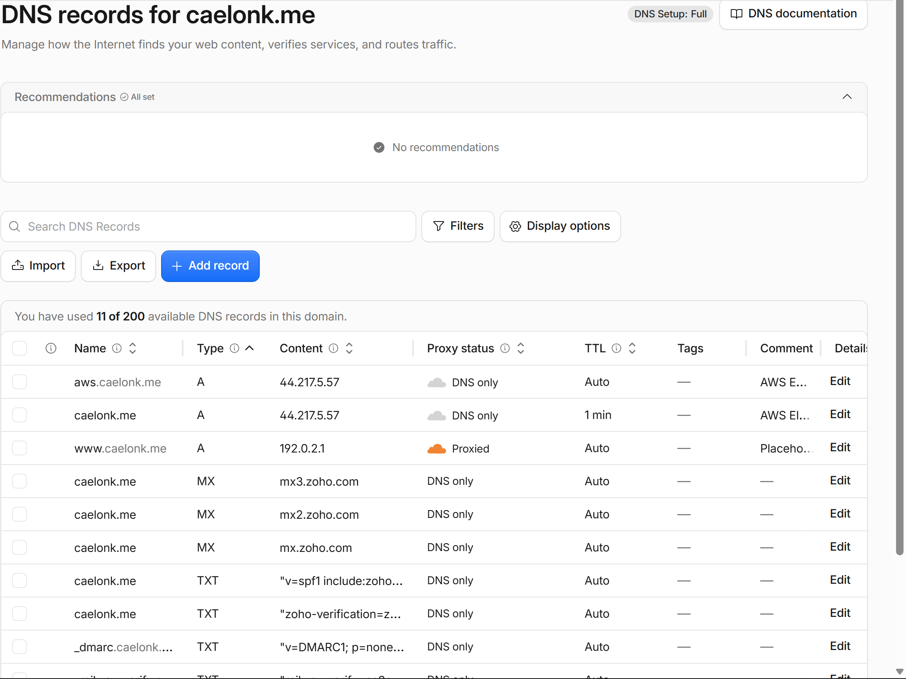
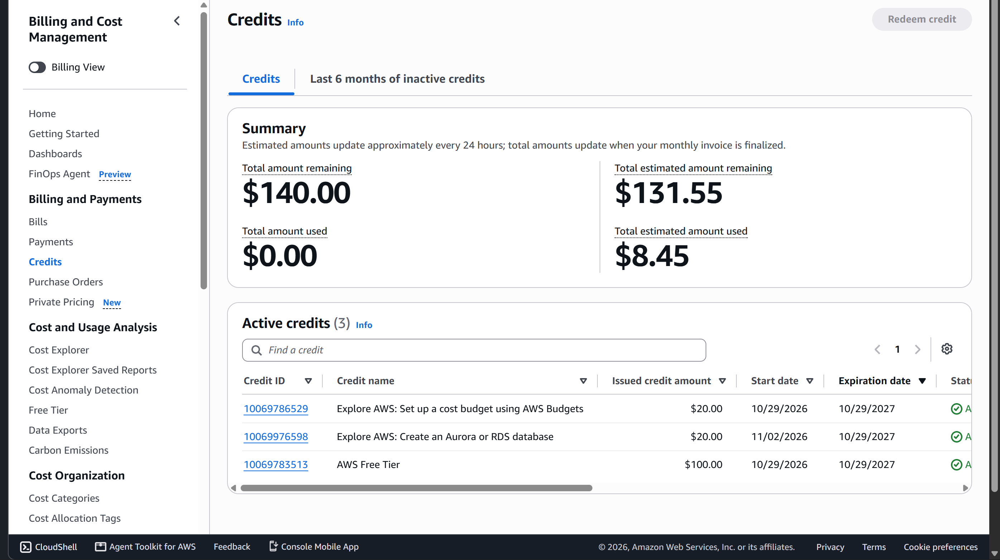

# Exercise 7 results: moving `caelonk.me` to AWS

All times are UTC. Architecture diagram: [README, "How it runs now (AWS)"](../../README.md#how-it-runs-now-aws).
Full check log: [`aws-verification-2026-11.md`](aws-verification-2026-11.md).

## 1. Architecture decision

I chose EC2 with a Single-AZ RDS PostgreSQL database over EC2 with PostgreSQL on the same
instance (and over Lambda + API Gateway, which would have needed app changes), because I
want AWS to handle database backups and patching, and I accept about $14 a month more (the two
RDS lines in the cost estimate) and one more service to secure and manage.

## 2. Backup record

| Item | Value |
|---|---|
| First backup and restore test | 2026-10-29 (Railway): restored into an empty PostgreSQL 18 container; row counts and a per-table content hash matched the live database for all 14 tables; the app served `/health` and `/` from the copy |
| Final backup before cutover | 2026-11-02 01:03 (`career_platform-final-20261102-010352Z.dump` + snapshots folder), checksums verified; this is the copy loaded into RDS |
| Latest backup | 2026-11-02 01:14, taken from AWS with the README procedure; restored locally with every table identical to the final Railway backup |
| Restore time measured | 9 seconds into an empty database (2026-10-30) |
| Data loss I accept (RPO) | 1 week. The site only changes when I edit it in `/admin`, so a week of edits can be redone by hand. Weekly dumps to my laptop and a private Google Drive folder meet it; RDS keeps only 1 day of automated backups (Free plan maximum) |
| Recovery time I accept (RTO) | 1 hour to restore into a new database and point the app at it |

## 3. Verification on the test subdomain `aws.caelonk.me`

Run 2026-11-02 while `caelonk.me` still pointed at Railway.

| What I tested | Evidence | Result |
|---|---|---|
| Deployed commit | `git rev-parse HEAD` on the server matched `origin/aws-migration` (`3199197`) | Pass |
| Data matches the backup | Per-table counts for all 14 tables, project slugs with published/featured flags, profile name: RDS vs a local restore of the same dump | Pass |
| App uses RDS over TLS | App settings show the RDS endpoint; `pg_stat_ssl` shows TLSv1.3; `sslmode=verify-full` | Pass |
| Target-only record survives restart | Unpublished project `aws-target-check` created in `/admin` on AWS; present before and after `systemctl restart`; deleted at cutover | Pass |
| Reboot | After `systemctl reboot`: app and Nginx active, `/health` ok, 5 published projects listed | Pass |
| Pages, assets, redirects | Home, 5 project pages, login, `/admin` → 303, 404 page, CSS, fonts, favicon, `resume.pdf` (same SHA-256 as live); `http://` → 301 `https://` | Pass |
| Uploads and integrations | Code review: the app has no uploads and no outside integrations | Not applicable |
| Certificate renewal | `certbot renew --dry-run` succeeded; `certbot.timer` enabled | Pass |
| Restricted SSH | Port 22 allowed from one `/32` only; password login refused; `passwordauthentication no` | Pass |
| RDS private, EC2 security group only | `PubliclyAccessible=false`; endpoint resolves to a private `172.31.x.x` address; port 5432 allowed only from the web security group; laptop → 5432 blocked | Pass |
| No extra ports | Laptop → 8000, 5432, 3306, 25 blocked | Pass |
| App behaviour when RDS is down | Not tested on AWS (tested earlier against local Postgres only) | Not verified |

## 4. Cutover status

**Done: 2026-11-02 at 01:05 UTC.** The Cloudflare record `caelonk.me` changed from a CNAME
to Railway to an A record for the Elastic IP `44.217.5.57`, DNS only. Mail records (MX,
SPF, DKIM, DMARC) and the `www` redirect were unchanged. Re-checked 2026-11-09:
`caelonk.me` resolves to `44.217.5.57`, `https://caelonk.me/` and `/health` return 200
from `nginx/1.24.0 (Ubuntu)` with a Let's Encrypt certificate for `caelonk.me` valid to
2027-01-31, `http://` and `www` redirect with 301 to `https://caelonk.me/`.

## 5. Cost

**Estimate:** $34.41 a month (EC2 `t3.small` $15.18, EC2 disk $1.60, public IPv4 $3.65,
RDS `db.t4g.micro` $11.68, RDS storage $2.30), about $1.13 a day, from AWS's public
us-east-1 price list, 2026-11-01. Details:
[README, "AWS monthly estimate"](../../README.md#aws-monthly-estimate-gate-g1-of-the-aws-plan).

**Billing page now (2026-11-09, owner's console, Credits page):** $140.00 of credits
($100 Free Tier, plus $20 for setting up a budget and $20 for creating an RDS database),
all expiring 2027-10-29. Estimated used **$8.45**, estimated remaining **$131.55**. The
November bill is $0.00, since credits cover it. $8.45 over about 8 days live is about $1.06
a day, close to the estimate. At the estimated rate the credits run out about 2027-03-05,
before they expire, so the resources must be deleted (or EC2 shrunk to `t3.micro`) by then.
The README still lists $120 expiring 2027-04-29 (read 2026-11-01, before the RDS credit
was added); this page is the current figure.

