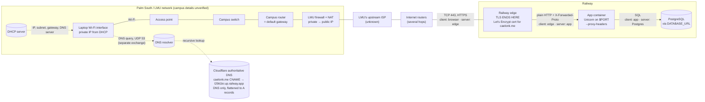
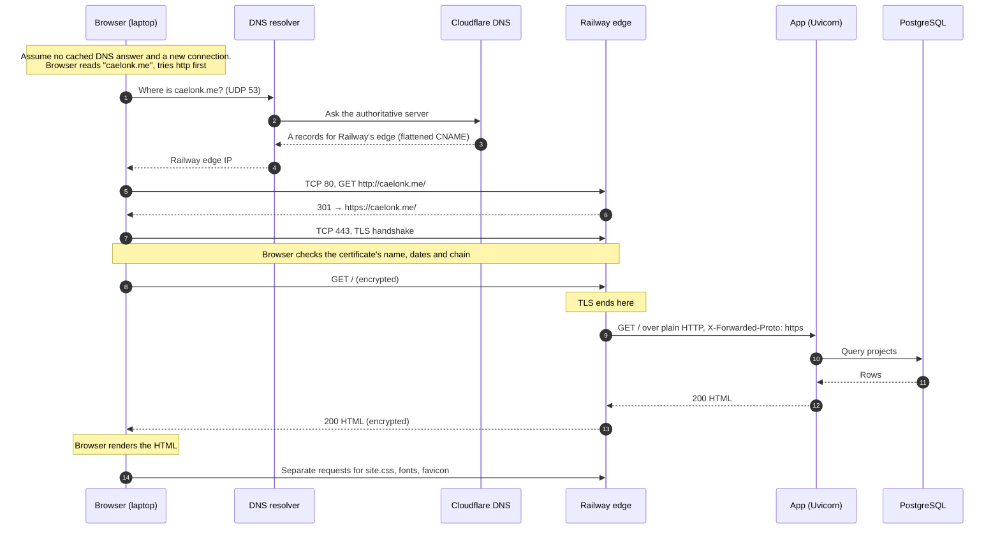

# Midterm request path: caelonk.me

What happens when I enter `caelonk.me` in a browser and press Enter. Drawn for Railway, where the site runs now, with what changes on Azure at the end.

Assumptions: no cached DNS answer, a new HTTPS connection over TCP, and the browser tries `http` first.

Anything marked "unverified" isn't backed by evidence in this repo. That covers the whole campus side, because the Exercise 01 network observations aren't stored here.

## 1. Hardware and services (where things are)

## 2. Order of events (when things happen)

## 3. What changes on Azure

| Part | Railway (above) | Azure VM |
|---|---|---|
| DNS answer | Flattened CNAME → Railway edge | `A @ 52.162.50.66`, DNS only |
| First thing the traffic hits | Railway edge | NSG (`vm-career-platformNSG`): 80 and 443 open to anyone, 22 only from my laptop |
| Where TLS ends | Railway edge | Nginx on port 443 on the VM (`10.0.0.4`) |
| Who owns the certificate | Railway issues and renews it | Certbot on the VM, renewed by `certbot.timer` |
| Path to the app | Edge → container on `$PORT` | Nginx → `127.0.0.1:8000` over loopback |
| Database | PostgreSQL service | SQLite file on the VM's disk |

## Sources in this repo

- DNS records: `docs/evidence/dns-after-zoho.md`
- Railway edge, redirect and domain setup: `docs/superpowers/plans/2026-10-08-railway-postgres-migration.md`
- Proxy headers and `$PORT`: `Dockerfile`
- Azure NSG, Nginx and where TLS ended: `docs/how-this-site-is-secured.md`
